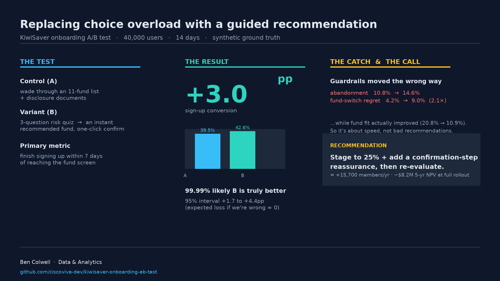

# KiwiSaver onboarding A/B test — a Bayesian decision case study

A portfolio project modelling a real problem for a NZ wealth platform: users
explore KiwiSaver but drop off at **fund selection**, paralysed by choice. It
runs the whole loop a Senior Data Analyst owns — event tracking (SQL/dbt),
experiment design, Bayesian inference, readable notebooks, and a
**commercial recommendation with a staged rollout and a guardrail trade-off**.

> ### TL;DR
> Replacing the fund-list browse step with a **3-question risk quiz (Variant B)**
> lifts sign-up conversion from **39.8% → 43.2%** (**+3.3pp**, 95% CrI +1.9 to
> +4.7; **P(B>A) = 100.0%**), worth an estimated **+17,300 members/yr and
> ~$8.7M in 5-year NPV** at full rollout.
>
> **But** B also raises post-selection abandonment (10.8% → 14.8%) and 14-day
> fund-switch regret (4.2% → 9.0%, **2.1×**), while *improving* fund fit (20.2% → 12.8%).
>
> **Recommendation: stage the rollout to 25%**, add a confirmation-step
> reassurance, and re-evaluate — not ship to 100%. The full reasoning and
> the notebooks walk through it in plain English.

📓 **Read the analysis notebooks directly on GitHub:**
- [`01_eda.ipynb`](notebooks/01_eda.ipynb) — first look at the data, funnel drop-offs, and assignment check.
- [`02_ab_test.ipynb`](notebooks/02_ab_test.ipynb) — Bayesian A/B test, decision loss, guardrails, and commercial model.
- [`03_bandits_and_peeking.ipynb`](notebooks/03_bandits_and_peeking.ipynb) — multi-armed bandits, Thompson sampling, and the peeking simulation.

🌐 **Browser-ready HTML portal:** [`docs/index.html`](docs/index.html) (pre-rendered, zero setup needed).

🖼️ **Deck-ready one-slide summary:** [`reports/figures/one_slide_summary.png`](reports/figures/one_slide_summary.png)



---

## ⚠️ Framing (read first)

- **Personal portfolio project. Not affiliated with, endorsed by, or produced
  for Sharesies.**
- **All customer/event data is synthetic**, generated by the committed simulator
  (`src/simulate.py`). **No real customer data was used or accessed.**
- Fund names, fee schedules, and the onboarding flow are taken from Sharesies'
  **public** website to model the domain faithfully, and are attributed in
  [`NOTICE.md`](NOTICE.md).

## 1. Business context & hypothesis

Sharesies' KiwiSaver join flow is three steps: answer a couple of questions,
build an investment plan (choose a **base fund**, optionally add self-select
picks), then submit. The hypothesis is that **decision paralysis at fund
selection** — 11 funds, return tables, disclosure PDFs — suppresses conversion,
and that a short guided quiz recommending a fund will convert better.

**Intervention.** Control (A) keeps the standard fund list. Variant (B) replaces
*only* the fund-selection step with a 3-question risk quiz that recommends a
base fund with one-click confirm.

| | Control — A | Variant — B |
|---|---|---|
| Fund selection | scroll 11 base funds + disclosure | 3-question quiz → recommended fund |
| Everything else | identical assignment, flow, and downstream steps | |

**Metrics**

| Type | Metric | Definition |
|---|---|---|
| Primary | Conversion | `submitted_application` within **7 days** of `viewed_fund_selection` |
| Guardrail | Post-selection abandonment | selected a fund, never confirmed |
| Guardrail | 14-day regret | switched base fund within 14 days of converting |
| Guardrail | Fund fit | selected fund risk ≠ self-reported profile |
| Secondary | Transfer balance | $NZD moved in |
| Secondary | 30-day contribution setup | set up a voluntary contribution |

The clock is anchored at `viewed_fund_selection` so both arms share a fair
starting line, and a 7-day window reflects the multi-session, high-consideration
nature of the decision (Sharesies' own transfer takes ~5–10 business days).

## 2. Data — synthetic by design

Real customer data is inaccessible and off-limits, so the experiment is
**simulated with a known ground truth** (`ground_truth.yaml`, committed). This
is a feature: it lets the pipeline *prove* it recovers the effect it injected
(`tests/test_recovery.py`) — something a public A/B dataset can never do.

- `40,000` users over `14` days, 50/50 split.
- Injected true lift: **+2.8pp**; recovered by the model: **+3.0pp**.
- Two raw tables emitted: `events` (one row per UI event, JSON metadata) and
  `users` (assignment + attributes). Deterministic from a pinned seed.

## 3. Method

```
raw events/users (parquet)
        │  dbt on DuckDB  (staging → intermediate → marts, + schema tests + SRM check)
        ▼
mart_experiment_users  ──►  Bayesian model (src/analyze.py)  ──►  results.json / figures
        │                                                         │
        └────────────►  notebooks (notebooks/*.ipynb)  ◄──────────┘
                              │  execute + render (src/render_notebooks.py)
                              ▼
                        docs/*.html   (plain-English, browser-readable, GitHub-Pages-ready)
```

- **Bayesian conjugate Beta-Binomial** as the primary model (analytic update +
  Monte Carlo for decision-theoretic outputs), with a **prior-sensitivity**
  run (`Beta(4,6)` vs `Beta(1,1)`).
- A **frequentist two-proportion z-test** as a cross-check — both agree.
- Decision outputs: `P(B>A)`, **expected loss** of choosing A vs B, credible
  intervals on absolute *and* relative lift.

Why Bayesian for a business decision? The question isn't "is this significant",
it's **"what's the cost of being wrong, and what should we do under
uncertainty"** — expected loss answers that directly.

## 4. Results


| Metric | A (control) | B (quiz) | Effect |
|---|---|---|---|
| **Conversion (primary)** | 39.8% | **43.2%** | **+3.3pp** (95% CrI +1.9 to +4.7), rel +8.3% |
| P(B > A) | — | — | **100.0%** |
| Expected loss of choosing B | — | — | **~0.00pp** |
| Frequentist cross-check | — | — | z = 4.75, p = 2.1e-6 |
| Post-selection abandonment (% of reached) | 10.8% | 14.8% | worse (95% CrI +3.1pp to +4.8pp) |
| Post-selection abandonment (% of selectors) | 19.6% | 23.6% | worse (95% CrI +2.4pp to +5.6pp) |
| 14-day fund-switch regret | 4.2% | 9.0% | **2.1× worse** (95% CrI +3.7pp to +5.8pp) |
| Fund/profile mismatch | 20.2% | **12.8%** | **better** (95% CrI -8.9pp to -5.9pp) |

**The interesting bit.** B is a near-certain win on conversion and even
*improves* fund fit — yet it raises regret. The mechanism isn't a bad
recommendation; it's **speed**. The quiz short-circuits the deliberation that
normally precedes a commitment, so more users later revisit their choice. A
conversion-only read would have shipped this and never seen it.


**Where the uplift concentrates** (see `mart_cohorts`): it is largest for
new-to-KiwiSaver and higher-growth profiles — the segment most likely to
regret, which reinforces the staged approach.

## 5. Commercial impact

KiwiSaver revenue is a **provider margin**, not the gross fund charge, so the
model uses a documented blended `0.75%` revenue rate on AUM (see
[`assumptions.md`](assumptions.md)). Expected AUM per converter ≈ **$18.1k**.

| | Full rollout | Staged 25% |
|---|---|---|
| Incremental members / yr | ~17,300 | ~4,300 |
| First-year revenue | ~$2.36M | ~$0.59M |
| **5-year NPV** | **~$8.71M** | **~$2.18M** |

## 6. Recommendation

**Stage the rollout to 25% + add a confirmation-step reassurance**, then
re-evaluate before 50% → 100%. The expected loss on conversion is essentially
zero, but the **2.1× regret** is a real trust cost that a full ship at once
would lock in. [`notebooks/02_ab_test.ipynb`](notebooks/02_ab_test.ipynb) walks
through the reasoning in plain English.

## 7. What I'd do next

- **Instrument & power the guardrails** — they run on smaller denominators.
- **Test the confirmation-step reassurance** as the mitigating variant.
- **Sequential / always-valid inference** to allow safe peeking.
- **CUPED** variance reduction to catch the guardrail effects sooner.
- **Novelty check** — compare day-1 vs day-7 uplift (none visible here, but on
  real traffic you must look).

## 8. Repo map & how to run

```
ground_truth.yaml   true parameters of the simulation (oracle; not read by analysis)
src/simulate.py     seeded synthetic event generator
src/analyze.py      Bayesian + frequentist analysis, figures, results.json
dbt/                DuckDB models: staging → intermediate → marts (+ tests, SRM check)
notebooks/          EDA + Bayesian A/B analysis, written in plain English
src/render_notebooks.py  executes the notebooks and renders them to HTML
docs/               rendered notebooks (browser-readable; GitHub-Pages-ready)
tests/              dbt tests + pytest effect-recovery tests
reports/            results.json, summary.md, figures/
assumptions.md      every assumption, with its source
```

Requires [`uv`](https://docs.astral.sh/uv/). One command builds everything:

```bash
make all        # data → models → report → notebooks
make notebooks  # just re-render the notebooks to docs/*.html
make test       # dbt tests + pytest (effect recovery)
```

Open [`docs/index.html`](docs/index.html) in a browser to read the analysis, or
open the notebooks in `notebooks/` directly.

<details>
<summary>Windows / no <code>make</code>? Run the same steps directly.</summary>

```powershell
uv sync
uv run python src/simulate.py
uv run dbt build --project-dir dbt --profiles-dir dbt
uv run python src/analyze.py
uv run python src/render_notebooks.py
```
</details>

## 9. How this maps to the Senior Data Analyst role

| JD requirement | Where it's demonstrated |
|---|---|
| Confident using **SQL** | `dbt/models/` (staging → marts, window + `FILTER` SQL, JSON parsing) |
| Hands-on **Python** | `src/simulate.py`, `src/analyze.py` (NumPy/SciPy/Pandas) |
| Data visualisation & **communicating results** | charts in `reports/figures/`; notebooks rendered to HTML in `docs/` |
| Conducting **A/B tests** | experiment design, power/MDE, SRM check, frequentist + Bayesian |
| Quantitative analysis in a **digital product** | event-based funnel, cohorts, device/segment cuts |
| Product analytics & **event-based data** | raw event stream → `mart_experiment_users` |
| **Snowflake** (nice-to-have) | dbt-on-DuckDB (same modelling paradigm; portable to Snowflake) |
| **Analytics engineering** (nice-to-have) | dbt DAG + tests; `int_funnel`, `mart_*` |
| **AI-enabled data tooling** (nice-to-have) | built end-to-end with an AI coding agent (scaffold → models → notebooks); the repo is structured so a coding agent can drive it (`make all`) |
| **Financial sector** (nice-to-have) | real fee/contribution/transfer domain modelling |
| Communicate with impact | README + plain-English notebooks + one-slide summary |

## 10. Limitations

Synthetic data validates the *method*, not a real business effect; NZ-only; no
genuine seasonality/novelty/interference; guardrail power < primary power. Full
list in [`assumptions.md`](assumptions.md).

---

**Built by Ben Colwell** — [GitHub](https://github.com/ciscoviva-dev) ·
[Portfolio](https://ben-colwell-portfolio.vercel.app) ·
[LinkedIn](https://www.linkedin.com/in/ben-colwell-bb5a43112/)
